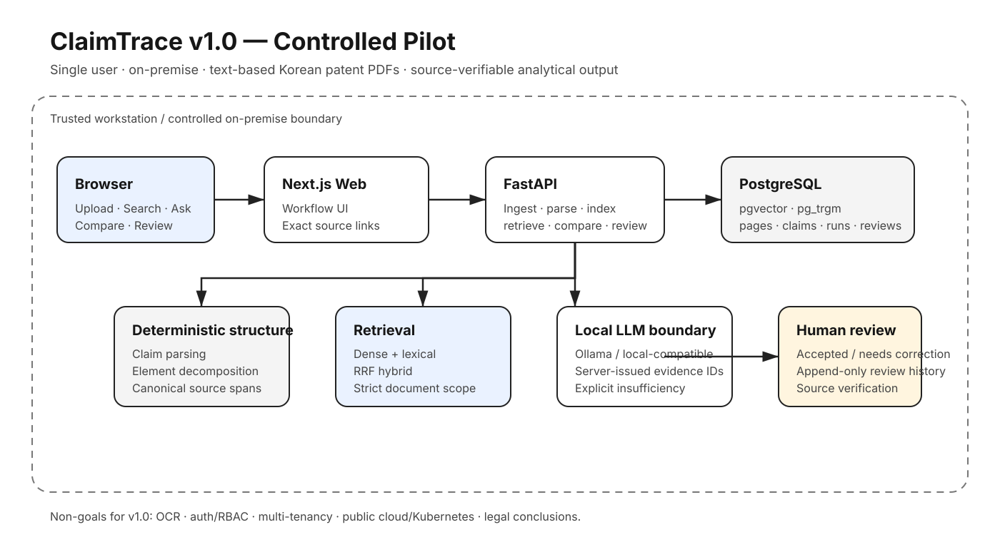
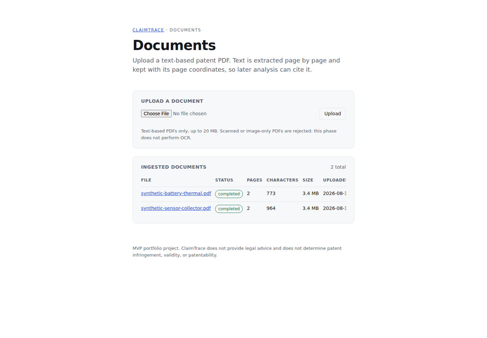
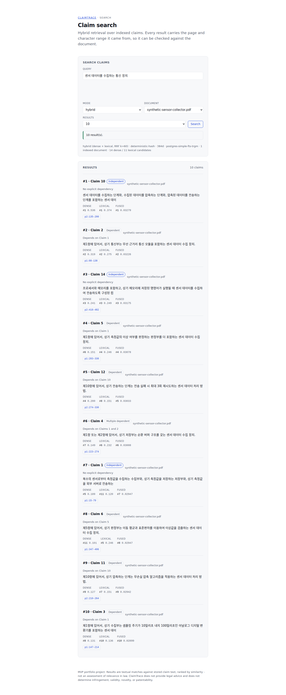
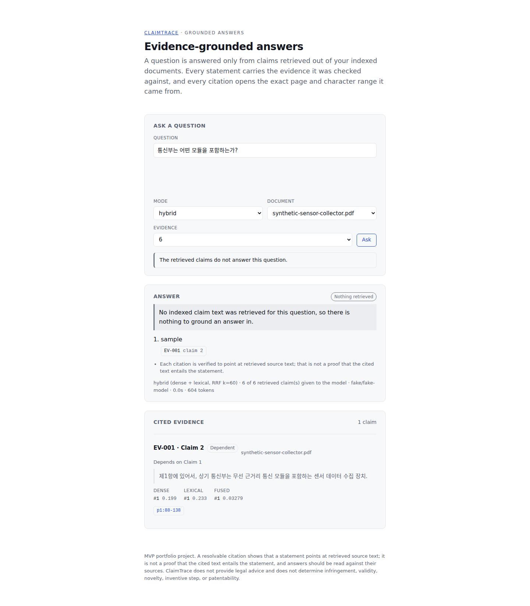
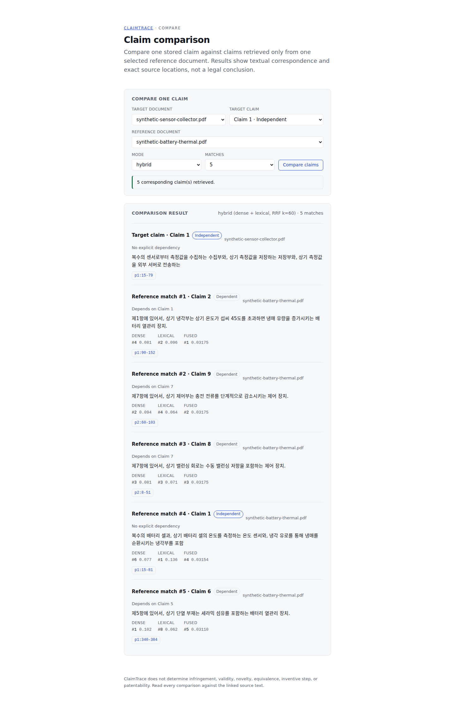
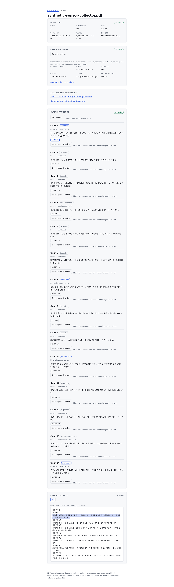
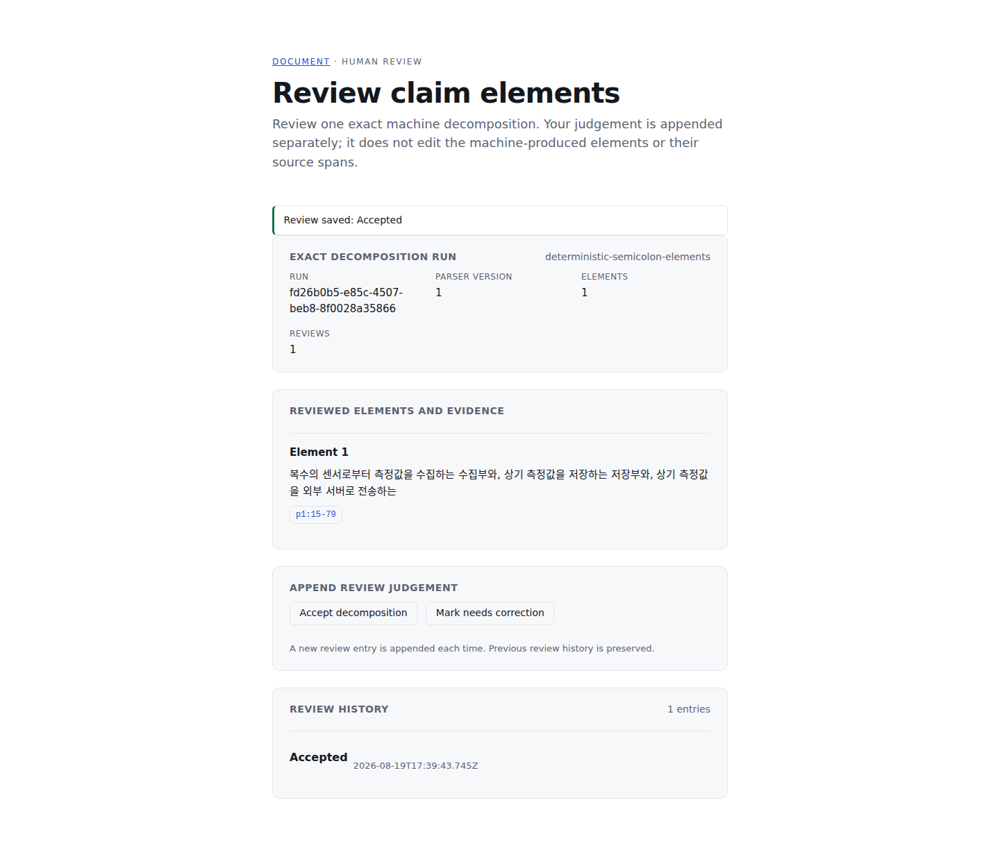

# ClaimTrace

**Source-verifiable patent claim analysis for a controlled on-premise workflow.**

ClaimTrace is a single-user pilot for text-based Korean patent PDFs. It ingests documents, preserves page-level provenance, parses and indexes claims, retrieves related evidence, produces evidence-grounded answers, compares claims across documents, decomposes claims into reviewable elements, and stores human review separately from machine output.

The product is deliberately bounded: **ClaimTrace does not provide legal advice and does not determine infringement, validity, novelty, equivalence, inventive step, or patentability.**



*The diagram above shows the v1.0 Proof boundary. `main` has since added capabilities it does not show; see [What `main` adds since the v1.0 Proof](#what-main-adds-since-the-v10-proof).*

## Why this exists

Patent-analysis tooling is only useful when a reviewer can verify where an analytical statement came from. ClaimTrace treats source provenance as a first-class constraint rather than a UI afterthought.

Every supported analytical surface is designed around a canonical locator:

`document_id → page_number → start_char → end_char`

That locator is persisted with document text and reused by claim parsing, retrieval, grounded Q&A, comparison, decomposition, and review (and, on `main`, by description-evidence retrieval). The model is not allowed to invent page numbers or arbitrary citations: grounded generation selects from server-issued evidence identifiers that the server resolves back to stored source spans.

## What the v1.0 controlled pilot can do

This is the capability list recorded at the v1.0 freeze (tag `v1.0-proof`). Later additions are listed in the next section.

1. Upload a text-based Korean patent PDF.
2. Validate, store, and extract page text.
3. Parse claim structure and dependencies.
4. Jump from a claim to its exact source span.
5. Index claims for dense, lexical, or hybrid retrieval.
6. Search and open any result at the persisted source range.
7. Ask an evidence-grounded question and receive cited statements or explicit insufficient evidence.
8. Select a target and reference document and compare a target claim under strict reference-document scope.
9. Decompose a claim into source-backed elements.
10. Record human review as `accepted` or `needs_correction` without overwriting machine output.
11. Navigate review output back to the original highlighted source text.

The v1.0 workflow is:

`ingest → parse → index → retrieve → ask → compare → decompose → review → verify source evidence`

## What `main` adds since the v1.0 Proof

The `v1.0-proof` tag is frozen and unchanged, and the committed assets under `docs/proof/` are byte-identical to the tag (checked 2026-11-11). `main` has moved on. The additions below are described in [`CLAIMTRACE_V1_MASTER.md`](CLAIMTRACE_V1_MASTER.md), whose Section 16 is the current-state summary. Each keeps the product boundary above.

- **Failed-ingestion retry.** A document whose ingestion failed can be retried from its persisted original through the API (`POST /api/v1/documents/{id}/retry`) and a form on the Documents page. Retry is allowed only for failed documents; otherwise the API answers `409` with error code `document_retry_not_allowed`.
- **Korean term-level lexical fallback.** Lexical retrieval can recover a near-identical token (for example a noun carrying a different particle) through a stricter trigram threshold. It is deliberately bounded and is not a general Korean morphological analyser.
- **Controlled-pilot handoff verifier.** `scripts/verify-controlled-pilot-handoff.sh` runs the clean-start, real-retry, and golden-path verifications and records hashes of the proof assets. See [`docs/CONTROLLED_PILOT_HANDOFF.md`](docs/CONTROLLED_PILOT_HANDOFF.md). It does not exercise the description, Case, real-public-corpus, or mixed-PDF additions below.
- **Real-public corpus verifier.** `scripts/verify-d3-real-corpus-inputs.sh` and hash-pinned acceptance tests use two public Korean patent PDFs listed in [`docs/real-public-corpus/manifest.json`](docs/real-public-corpus/manifest.json). The PDFs are downloaded at run time and are not committed.
- **Description evidence.** Description text can be derived into segments, indexed, and searched (`POST /api/v1/documents/{id}/descriptions/derive`, `.../descriptions/index`, `POST /api/v1/search/descriptions`). **API only, no dedicated UI:** a result carries a `source_url` that opens the existing document page at the source range. Grounded answers remain claim-only. See [`docs/D4_DESCRIPTION_AWARE_EVIDENCE.md`](docs/D4_DESCRIPTION_AWARE_EVIDENCE.md).
- **Analyst Cases.** A Case groups documents and stores grounded results that can be listed and reopened (`/api/v1/cases...`). **API only, no UI.** The stateless `POST /api/v1/grounded/answers` endpoint is unchanged.
- **Mixed-PDF classification.** The text layer is classified per page; a PDF with any text-empty page is rejected as mixed or ambiguous rather than ingested partially. This is conservative: it can reject a text-native PDF that contains a blank or drawings-only page. There is still no OCR.

## Product proof

The assets in this section are the **v1.0 Proof snapshot**, generated at the v1.0 freeze and unchanged since (see [`docs/proof/README.md`](docs/proof/README.md)). They show the v1.0 application, not the later additions above. They are generated from the deterministic whole-product runtime used by the repository verification path, not hand-authored mockups.

### Documents and persisted corpus



### Hybrid retrieval with exact source links



### Evidence-grounded answer



### Bounded claim comparison



### Exact source verification



### Persisted human review



A concise recorded golden-path run is committed at [`docs/proof/demo/claimtrace-golden-path.webm`](docs/proof/demo/claimtrace-golden-path.webm).

## Executed evidence

These numbers come from executed GitHub-visible verification recorded in [`CLAIMTRACE_V1_MASTER.md`](CLAIMTRACE_V1_MASTER.md). **They were recorded at the v1.0 freeze (tag `v1.0-proof`) and are kept unchanged as a historical record. They are not current measurements of `main`** and are not claims about general patent-analysis accuracy. Current-state facts are in the next subsection.

### Operational verification (recorded at the v1.0 freeze)

- clean checkout + empty database migration: **GREEN**;
- Alembic `0001 → 0006 (head)` from an empty PostgreSQL database: **PASS**;
- deterministic whole-product browser golden path: **PASS**;
- backend database-free tier: **785 PASS**;
- PostgreSQL integration tier: **135 PASS / 0 skipped**;
- Ruff lint/format and frontend ESLint/TypeScript: **GREEN**;
- expected failure-state verification: **5 PASS**.

### Retrieval evaluation (recorded at the v1.0 freeze)

Synthetic regression corpus: **26 claims / 19 queries**.

| Mode | Recall@1 | Recall@3 | Recall@5 | MRR@10 |
| --- | ---: | ---: | ---: | ---: |
| Dense | 0.7696 | 0.9265 | 0.9706 | 0.9608 |
| Lexical | 0.7402 | 0.8971 | 0.9118 | 0.9608 |
| Hybrid RRF | 0.7990 | 0.9265 | 0.9412 | 1.0000 |

This is a small synthetic regression set for reproducibility and ranking regressions, **not a benchmark-quality claim about patent retrieval**.

### Grounded deterministic evaluation (recorded at the v1.0 freeze)

16 committed cases:

- structured output: `1.000`;
- answerability: `1.000`;
- insufficient-evidence precision / recall: `1.000 / 1.000`;
- citation resolution: `1.000`;
- statement citation coverage: `1.000`;
- evidence-ID validity: `1.000`;
- evidence selection precision / recall: `1.000 / 0.9167`;
- end-to-end success: `0.9375`;
- forbidden cross-document citations: `0`;
- hostile grounding payloads refused: **6 / 6**.

The known weak case `g01-single-storage` remains visible: retrieval did not supply the required labelled claim, so end-to-end success is intentionally not represented as `1.000`.

### Current state (2026-11-11)

Checked on the `f59f4df` tree during the first wrap-up; details in [`CLAIMTRACE_V1_MASTER.md`](CLAIMTRACE_V1_MASTER.md) Section 16.

- Alembic head is `0009` (single linear chain `0001 → 0009`).
- Backend database-free tier (`pytest -m "not integration"`): **798 passed, 144 deselected**, run locally.
- PostgreSQL integration tier: 144 tests. **Not run locally in the wrap-up** (no Docker or pgvector available); General CI runs it on pull requests.
- Ruff lint and format: passed. Web ESLint: 0 errors, 2 warnings. TypeScript `tsc --noEmit`: passed.
- **Evaluation-artifact caveat.** The committed result files (`apps/api/evals/results/results.json` and `apps/api/evals/results/grounded/results-deterministic.json`) were generated on 2026-07-26 with the `intfloat/multilingual-e5-small` profile. Lexical retrieval changed afterwards. The tables above therefore describe that earlier run. The enforced gate `make verify-deterministic-regression` pins a fake-provider baseline in which `g01-single-storage` must succeed. **Current real-embedding numbers were not re-measured.**

## Architecture

ClaimTrace runs inside a trusted workstation or controlled on-premise boundary:

```text
Browser
  ↓
Next.js Web
  ↓ HTTP
FastAPI
  ├─ document ingestion + canonical page/source persistence
  ├─ deterministic claim parsing + element decomposition
  ├─ dense / lexical / RRF retrieval
  ├─ local/self-hosted LLM provider boundary
  ├─ bounded claim comparison
  └─ append-only human review state
  ↓
PostgreSQL 17 + pgvector + pg_trgm
```

Description evidence and analyst Cases (added after v1.0, API only) sit beside the claim pipeline. The block below is an addition since v1.0 and is not in the SVG:

```text
FastAPI (addition since v1.0)
  ├─ description-evidence derive / index / search   → source_url deep link into the document page
  └─ analyst Cases + persisted grounded results     (no UI)
```

Detailed design, extension points, and known gaps live in [`docs/ARCHITECTURE.md`](docs/ARCHITECTURE.md). The architecture SVG at the top of this page shows the v1.0 boundary only.

## Reproduce the controlled pilot

### Prerequisites

- Docker Engine / Docker Desktop with Compose v2
- `make` (the scripts call `make init` when `.env` is missing) and `curl`
- Node.js 22+ and network access for browser proof capture (`npm ci`, Playwright and Chromium download)
- For the real-public corpus verifier only: `python3` and `pdftotext`, plus network access to download the PDFs
- For `scripts/verify-controlled-pilot-handoff.sh` additionally: `sha256sum` (`git` is optional and only records the commit). The real-retry step installs Chromium with `--with-deps`, which may need root or apt access

### Start the application

```bash
cp .env.example .env

docker compose up --build -d postgres
docker compose run --rm api alembic upgrade head
docker compose up -d api web
```

Default surfaces:

- Web: `http://localhost:3000`
- Documents: `http://localhost:3000/documents`
- Search: `http://localhost:3000/search`
- Grounded Q&A: `http://localhost:3000/grounded`
- Compare: `http://localhost:3000/compare`
- LLM status and diagnostics: `http://localhost:3000/llm`
- Review of a decomposition run: `http://localhost:3000/reviews/{runId}`
- API: `http://localhost:8000`
- API docs: `http://localhost:8000/docs`

This Compose stack is a local-development stack with no authentication. Its host ports (postgres, api, web, and ollama under the `llm` profile) are published without a host address, so they are reachable on every network interface of the host. Do not run it on a shared network without binding the ports to loopback or restricting access.

### Re-run the deterministic proof capture

> **Warning: by default this overwrites the committed Proof assets.** `scripts/capture-v1-07-proof.sh` writes to `docs/proof` and first runs `rm -rf` on `docs/proof/screenshots` and `docs/proof/demo`. To keep the v1.0 snapshot intact, redirect the output first, for example `V1_07_PROOF_DIR=/tmp/claimtrace-proof sh scripts/capture-v1-07-proof.sh`. The script still requires `docs/proof/architecture-v1.svg` to exist.

Install the browser runner in `apps/web`, then execute:

```bash
cd apps/web
npm ci
npm install --no-save --package-lock=false playwright@1.55.0
npx playwright install chromium
cd ../..

sh scripts/capture-v1-07-proof.sh
```

The capture uses the committed deterministic two-document seed, fake embedding provider, and fake LLM provider so it does not depend on a hosted model service.

## Technology

| Layer | Choice |
| --- | --- |
| Backend | Python 3.12, FastAPI, Pydantic v2, SQLAlchemy 2.x async, Alembic, psycopg 3, PyMuPDF |
| Database | PostgreSQL 17, pgvector, pg_trgm |
| Retrieval | multilingual embeddings, PostgreSQL lexical retrieval, Reciprocal Rank Fusion |
| Frontend | Next.js App Router, React, TypeScript |
| LLM boundary | Ollama, OpenAI-compatible local server, deterministic fake provider |
| Verification | pytest, Ruff, ESLint, TypeScript, Playwright, Docker Compose, GitHub Actions |

## Known limitations

- **Text-based PDFs only.** OCR is not implemented; it is a deferred candidate for a future destination, not a selected one. A PDF with no extractable text fails explicitly. Since the D6-01 change, a PDF in which any page has no extractable text (including a blank or drawings-only page in an otherwise text-native file) is rejected as mixed or ambiguous. A scan that already carries an embedded text layer is treated as text, and ClaimTrace does not judge that layer's quality.
- **Cases and description search have no UI.** They are reachable only through the API (and the `source_url` deep link into the document page). Grounded answers remain claim-only; description evidence is not an input to grounded generation.
- Korean claim parsing is deterministic and intentionally bounded; it is not represented as a universal patent parser.
- Citation resolvability proves that a statement points to stored evidence; **it does not prove semantic entailment or legal correctness**.
- Retrieval and grounded metrics above use committed synthetic corpora intended for regression verification. They are v1.0-freeze figures; see the evaluation-artifact caveat under Current state.
- The V1-07 GitHub-hosted evaluation could not access a local Ollama endpoint. The historical `qwen2.5:1.5b` run remains historical only; **real-local-model quality was not rerun for the V1-07 proof tier** and has not been rerun since.
- No authentication, RBAC, multi-tenancy, public-cloud deployment, Kubernetes, billing, or admin console is part of this controlled pilot.
- Human review is an explicit product boundary. Machine decomposition is not silently promoted to reviewer judgement.

## Repository map

```text
claim-trace/
├── apps/api/                 FastAPI, migrations, tests, evaluations
├── apps/web/                 Next.js UI and browser verification
├── docs/proof/               v1.0 proof architecture, screenshots, demo asset (frozen)
├── docs/ARCHITECTURE.md      detailed internal architecture
├── docs/ROADMAP.md           phase-by-phase build history and status
├── docs/CONTROLLED_PILOT_HANDOFF.md   one-command handoff verifier
├── docs/D4_DESCRIPTION_AWARE_EVIDENCE.md   description-evidence brief
├── docs/real-public-corpus/  manifest for the hash-pinned public PDFs
├── infra/                    PostgreSQL initialization
├── packages/                 placeholder; nothing extracted yet
├── tests/                    cross-cutting test notes
├── scripts/                  reproducible verification/capture runners
├── .github/workflows/        16 PR-triggered CI and verification workflows
├── Makefile                  local development and verification targets
├── CLAIMTRACE_V1_MASTER.md   authoritative ledger: v1.0 Proof and post-v1 progression
└── docker-compose.yml        local-development runtime
```

## Status

The v1.0 controlled-pilot implementation, deterministic validation, proof packaging, and final Human Review are complete. The reviewed Proof is **`CLAIMTRACE PROOF v1.0 CLOSED / FREEZE — HUMAN REVIEW PASSED`**. Remote annotated tag `v1.0-proof` is verified to dereference to reviewed commit `bcb37b1a86ae70e2f35cdab6708da9310d7e9e2d`. The tag is frozen and unchanged, and `docs/proof/` on `main` is byte-identical to it.

`main` has moved past the tag. As of the 2026-11-11 first wrap-up, the post-v1 milestones P1-P14 and destinations D1-D6 are recorded as closed in the ledger (D6 at the fail-closed boundary; OCR deferred), and **no milestone is active**. The next destination needs a human decision; candidate options are listed in the ledger and none is selected.

For the current state, exact workflow evidence, open items, and limitations, read [`CLAIMTRACE_V1_MASTER.md`](CLAIMTRACE_V1_MASTER.md), starting with Section 16.

---

MIT License. See [`LICENSE`](LICENSE).